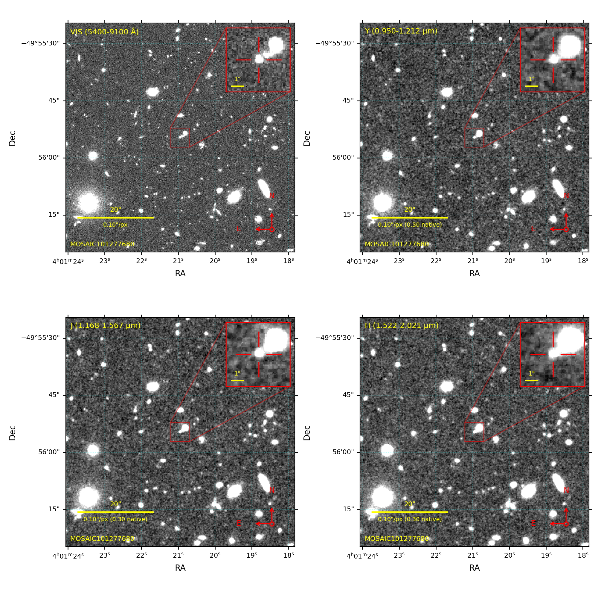

# euclid-cutouts

Terminal command that grabs Euclid archive images at a sky position.

It queries the ESA Euclid Science Archive (astroquery.esa.euclid) for image
products whose footprint covers the position, fetches a FITS cutout per
band, and displays them in a collage. `--download` saves the FITS files.

Public DR1/Q1 data only, no login required.


## Install

```bash
pip install -r requirements.txt
ln -s "$(pwd)/euclid-cutouts.py" ~/.local/bin/euclid-cutouts
```

The `--gui` viewer additionally needs PySide6 or PyQt6
(`pip install pyside6`); it also runs standalone:
`python3 utils/fits_viewer.py image1.fits image2.fits ...`

## Usage

```bash
euclid-cutouts 60.3372991 -49.9318588
```

That fetches the covering cutouts and shows them in a figure. Nothing
is kept on disk unless `--download` is given. With no display
available, the figure is written to `euclid_collage_<ra>_<dec>.png`
instead.

Coordinates work as `ra dec`, `ra,dec`, or a sexagesimal string. A
non-coordinate argument is treated as an object name and resolved
through Sesame (SIMBAD, NED, VizieR); transient names like `2026abc`
are tried under the SN and AT prefixes automatically.

```bash
euclid-cutouts 2026abc
```




| flag | effect |
|---|---|
| `-r 60` | cutout radius in arcsec (default 30, max 1800) |
| `--size 90` | cutout width in arcsec; alternative to `-r` (size = 2 x radius) |
| `--download` | save the FITS cutouts; without it they are displayed but not kept. Writing to your home directory asks first |
| `--no-plot` | do not display the figure; alone it only reports coverage |
| `-b VIS,NIR_Y` | band list; `euclid` (default) = VIS + NIR_Y/J/H, `all` adds DECAM/HSC/MEGACAM/PANSTARRS |
| `--release q1` / `both` | release to search; dr1 is the default, q1 is tried when dr1 has no coverage |
| `--all` | fetch every covering product, not one per band |
| `--include-raw` | for bands with no processed image, fetch raw detector frames and cut out the covering detector |
| `--full` | save the full product file instead of a cutout (needs `--download`) |
| `-l` | list covering products without fetching |
| `--pub` | write `euclid_collage_<ra>_<dec>.pdf` + `.png` at journal column size (vector text, 300 dpi) instead of displaying |
| `--gui` | open the Qt image viewer instead of the static figure: all images in a grid with linked sky views (pan/zoom one, all follow), per-image cut and stretch controls on the selected panel, one colormap for the grid, Ctrl-click the list plus "Selected only" to show a subset, histogram with draggable cut lines, shared crosshair by RA/Dec or click with size and colour controls, Recentre button centroid-refines the mark within 6 px, Save figure exports PNG/PDF |
| `-o dir` | output directory for saved files (default: cwd); implies `--download` |
| `--no-header-fix` | skip the keyword stamping |


